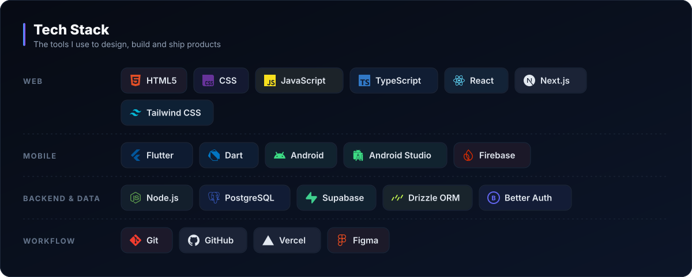
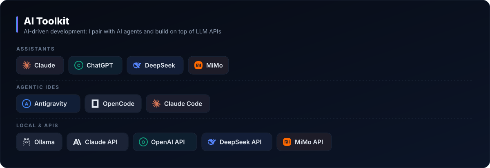

  

  

  
  
  

  

## 👋 About Me

I'm **Nishan**, a developer from **Bangladesh** who builds **SaaS products, web apps, Android apps, Telegram bots and AI-powered tools**, end to end: UI, backend, database, auth and deployment.

I work **AI-first**. Agents like Claude Code, Antigravity and OpenCode speed up the routine work, while I own the architecture, review every line and ship code I fully understand. The stack is never a blocker: if a project needs something new, I learn it and deliver.

## ⚡ What I Do

<table>
  <tr>
    <td width="50%" valign="top">
      <h3>🌐 Web Apps &amp; SaaS</h3>
      Full-stack products with <b>Next.js</b>, <b>TypeScript</b> and <b>Node.js</b>: dashboards, auth, databases, payments-ready architecture and fast deployments.
    </td>
    <td width="50%" valign="top">
      <h3>📱 Android Apps</h3>
      Cross-platform mobile apps with <b>Flutter</b> and <b>Dart</b>: smooth, native-feeling UI backed by Firebase, Supabase or a custom API.
    </td>
  </tr>
  <tr>
    <td width="50%" valign="top">
      <h3>🤖 Telegram Bots &amp; Automation</h3>
      Bots, webhooks and scheduled jobs in <b>Python</b> and <b>Node.js</b> that automate the boring parts of a business.
    </td>
    <td width="50%" valign="top">
      <h3>🧠 AI Integration</h3>
      Products built on <b>LLM APIs</b> (Claude, OpenAI, DeepSeek, MiMo) and local models via <b>Ollama</b>: assistants, chatbots and smart tools.
    </td>
  </tr>
</table>

## 🚀 Products &amp; Tools

  
  

More tools are on the way. Watch this space.

## 🧰 Tech Stack

  

  

## 📂 Selected Repositories

| Repository | What it is |
| --- | --- |
| [**wellora**](https://github.com/itznishandev/wellora) | Healthcare SaaS dashboard with real auth and database · [live demo](https://wellora-theta.vercel.app/) |
| [**EventManagement_Client**](https://github.com/itznishandev/EventManagement_Client) | Client app for browsing and managing events |
| [**webdeveloper-portfolio**](https://github.com/itznishandev/webdeveloper-portfolio) | My personal developer portfolio |

## 🔭 Currently Building

- 🛠️ **More useful tools.** Free web tools like socialdownloder that solve real, everyday problems.
- 💼 **SaaS products.** Small, focused products with subscriptions and clean dashboards.
- 🤝 **A developer community.** A place for Bangladeshi developers to learn, build and ship with AI.

## 📊 GitHub Activity

  

  <picture>
    <source media="(prefers-color-scheme: dark)" srcset="https://raw.githubusercontent.com/itznishandev/itznishandev/output/github-snake-dark.svg" />
    <source media="(prefers-color-scheme: light)" srcset="https://raw.githubusercontent.com/itznishandev/itznishandev/output/github-snake.svg" />
    
  </picture>

## 🤝 Let's Build Something

Have a SaaS idea, an app, a bot or a tool in mind? I'm open to **freelance projects, collaborations and full-time roles**.

  
  

  Designed &amp; built by Nuruzzaman Nishan · Bangladesh 🇧🇩

